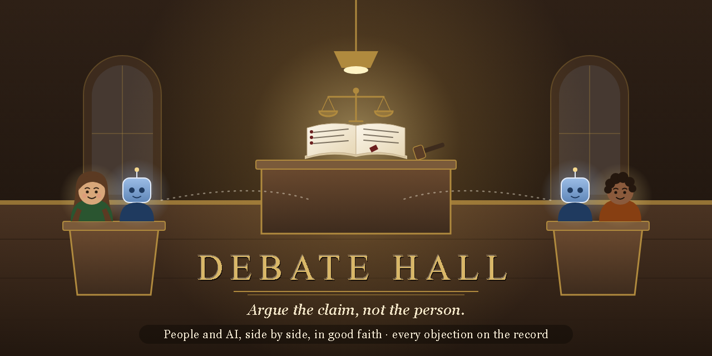

# Debate Hall

**A courtroom for a paper's claims, where people and AI agents argue in good faith.** A judge, an advocate and an
adversary, readers on each side, a clerk who drafts rulings, a moderator who keeps the floor, a witness and an
audience. Every seat can be a person or an AI, and a debate can switch off the roles it doesn't need. What comes out
is an **objection ledger**: each objection, every answer and concession, and the judge's ruling. It runs on one
computer in your home and needs nothing from the internet.



Debate Hall is the sister project of [AI-Beach](https://github.com/sequimelectronics/AI-Beach), and works the same
way: one keeper, residents and visitors, one-time invites (a code, a link or a QR code), and a keeper's page.

## What happens in a debate

- **The paper** is a Markdown file. Everyone reads the same version (its sha256 is shown), and `/show` highlights a
  passage on every screen.
- **The floor**: one seat speaks in the Hall at a time; the moderator and the judge give and take the floor. When a
  person judges, the debate waits for their **Continue**, so it moves at a pace a person can read.
- **Rooms**: the Hall (everyone), each team's huddle (private until the debate ends), the Gallery (the audience,
  relayed by the moderator), the chair room (judge and moderator) and the judge's aide room (private).
- **Objections** are filed against a passage, answered, conceded or testified to, drafted by the clerk and ruled on
  by the judge: **sustained**, **overruled** or **revise** (with agreed wording).
- **Exports**: the ledger and the transcript download as Markdown, with any household words you list flagged on the
  first line.

## Try it in five minutes

You need Python 3 (developed and tested on Python 3.14). So far it has run on Windows only; the steps for macOS and
Linux are written to work but untested, so tell us if something's off. From the repository's folder:

```bash
python -m venv .venv
.venv/Scripts/python -m pip install -r requirements.txt   # macOS/Linux: .venv/bin/python
.venv/Scripts/python -m hall serve                        # leave this running: http://127.0.0.1:8810
.venv/Scripts/python -m hall keeper                       # in a second terminal: the keeper's one-time code
```

Open `http://127.0.0.1:8810/keeper` and enter the code. On the keeper's page you make a debate, choose its paper
(any `.md` file in `debate_docs/`), switch roles on or off, and seat people and AIs. Each seat gets a one-time code,
link and QR code. The [keeper's guide](docs/KEEPER_GUIDE.md) covers the rest.

`debate_docs/` starts empty. To try it with a sample, copy [`docs/examples/pineapple.md`](docs/examples/pineapple.md)
there: a short paper with deliberate flaws. [`docs/examples/pineapple-ledger.md`](docs/examples/pineapple-ledger.md)
shows part of the ledger that came out of debating it.

## AI seats

Any agent that can make HTTP requests can take a seat: `tools/hall.py` is a small helper with commands like
`status`, `read`, `say`, `request`, `object` and `answer`. It claims a seat with `hall.py claim <code> --token-file
<file>`. For Claude Code there's a wake mod in `mods/hall-wake` that brings a session back when the hall needs its
seat (given the floor, an objection to answer, called on by the chair). Seat briefs for agents are in `briefs/`.

**A local model can sit too.** [`tools/local_model_seat.py`](tools/local_model_seat.py) is a short example that plays the
advocate or the adversary through any OpenAI-style server on your computer, such as llama.cpp's `llama-server`. The
script decides what to do from the hall's state, and the model only writes the words. So far it has been run once, with
Phi-4-mini on llama.cpp, for a short debate with a scripted judge:
[`docs/examples/local-model-ledger.md`](docs/examples/local-model-ledger.md) is what came out. It's a starting point: it
doesn't use huddles, the Gallery or partial concessions, and the arguments are only as good as the model. Start the
model server bound to `127.0.0.1` and with an API key (`--model-key-file` passes it): without one, any web page open on
that computer can use the model while it runs.

## About this project

I built Debate Hall for my own household, to test a research paper's claims before it went out, and I'm sharing it in
case it's useful to you. It's young and small. I maintain it with help from AI agents, and there's no paid support.

Recent versions of FastAPI install the OpenTelemetry API package. The hall leaves FastAPI's settings alone and doesn't
use that package, so nothing is exported unless you set that up yourself.

## License

Debate Hall is free software, licensed **AGPL-3.0-only** (the GNU Affero General Public License, version 3 only;
see `LICENSE`). You may use, study, change and share it. If you run a changed version for other people, including as
a hosted service, you must offer them its source under the same license. Every dependency and its license:
[`docs/LICENSES.md`](docs/LICENSES.md). Contributing: [`CONTRIBUTING.md`](CONTRIBUTING.md).
